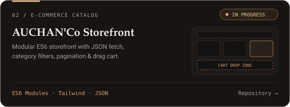
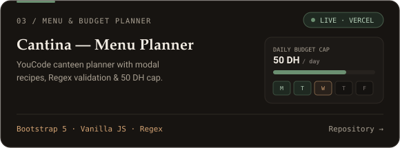
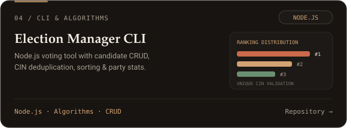
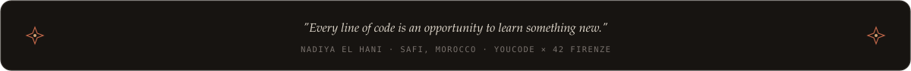

<!-- HERO MISSION CONTROL HEADER -->

  

<!-- QUICK ACTION BAR -->

  
  
  
  <!-- Uncomment and replace YOUR_LINKEDIN_HANDLE once ready:
  
  -->
  

<!-- 42 FIRENZE SKILL TELEMETRY & VELOCITY BENTO -->

 

<!-- FEATURED PROJECTS — CLICKABLE ANIMATED BENTO CARDS -->
<h3 align="left">⚡ ACTIVE SHIPMENTS &amp; FEATURED BUILDS</h3>

<table>
  <tr>
    <td width="50%" align="center">
      
       
      <a href="https://nadiyaelhani-lab.github.io/smart-stream-tv-v2/"><code>🌐 Live Demo</code></a> &nbsp;·&nbsp;
      <a href="https://github.com/nadiyaelhani-lab/smart-stream-tv-v2"><code>📂 Repository</code></a>
    </td>
    <td width="50%" align="center">
      
       
      <a href="https://github.com/nadiyaelhani-lab/AUCHAN-Project"><code>📂 Repository</code></a> &nbsp;·&nbsp;
      <a href="https://github.com/nadiyaelhani-lab/AUCHAN-Project/issues"><code>📋 Roadmap Issues</code></a>
    </td>
  </tr>
  <tr>
    <td width="50%" align="center">
      
       
      <a href="https://cantina-hopeso.vercel.app"><code>🌐 Live Demo</code></a> &nbsp;·&nbsp;
      <a href="https://github.com/nadiyaelhani-lab/Cantina"><code>📂 Repository</code></a>
    </td>
    <td width="50%" align="center">
      
       
      <a href="https://github.com/nadiyaelhani-lab/finalProjectSAS"><code>📂 Repository</code></a>
    </td>
  </tr>
</table>

 

<!-- LIVE GITHUB TELEMETRY -->
<h3 align="left">📡 LIVE GITHUB TELEMETRY</h3>

<table>
  <tr>
    <td width="54%" align="center">
      
    </td>
    <td width="46%" align="center">
      
    </td>
  </tr>
  <tr>
    <td colspan="2" align="center">
      
    </td>
  </tr>
</table>

 

<!-- ANIMATED FOOTER -->

