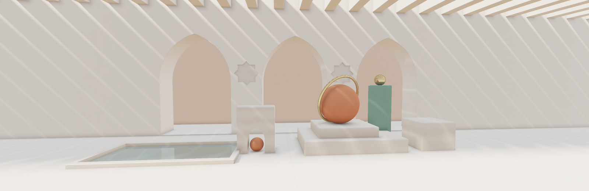

  

## Nadiya El Hani

**Software Development Student** · YouCode Safi, Morocco · **42 Firenze Cadet** (`nael-han`)

I study full-stack web development at **YouCode Safi** and recently entered the **42 Firenze** Common Core after validating the C Piscine at Level 4.55. Most of my current work focuses on JavaScript (ES6+), responsive web interfaces, and low-level C fundamentals (`Libft`).

---

### Selected Projects

| Project | Description | Stack | Links |
| :--- | :--- | :--- | :--- |
| **Smart Stream TV V2** | IPTV channel manager with MockAPI CRUD, live search, favorites, and blacklist/restore flows. | JavaScript ES6+, Tailwind CSS, MockAPI | [Live Demo](https://nadiyaelhani-lab.github.io/smart-stream-tv-v2/) · [Code](https://github.com/nadiyaelhani-lab/smart-stream-tv-v2) |
| **AUCHAN'Co** *(WIP)* | E-commerce catalog using Fetch JSON, category filtering, configurable pagination, and drag-and-drop cart foundations. | HTML5, Tailwind CSS, ES6 Modules | [Live Demo](https://nadiyaelhani-lab.github.io/AUCHAN-Project/) · [Code](https://github.com/nadiyaelhani-lab/AUCHAN-Project) |
| **Cantina** | Weekly canteen planner for YouCode featuring modal recipe creation, live Regex validation, and a 50 DH/day budget model. | HTML5, CSS3, Bootstrap 5, JavaScript | [Live Demo](https://nadiyaelhani-lab.github.io/Cantina/) · [Vercel](https://cantina-hopeso.vercel.app) · [Code](https://github.com/nadiyaelhani-lab/Cantina) |
| **Smart Stream IPTV (V1)** | First-iteration live TV catalog built with ES6 modules, Fetch API, and category search. | JavaScript ES6+, Tailwind CSS, MockAPI | [Live Demo](https://nadiyaelhani-lab.github.io/smart-stream-iptv/) · [Code](https://github.com/nadiyaelhani-lab/smart-stream-iptv) |
| **Election Manager CLI** | Node.js terminal application with candidate CRUD, unique-CIN voter validation, ranking sort, and party statistics. | JavaScript, Node.js | [Code](https://github.com/nadiyaelhani-lab/finalProjectSAS) |

### Background & Tools

- **42 Firenze (`nael-han`)** — Validated the July–August 2026 C Piscine at **Level 4.55** (9/14 modules passed, `C 04` 85%, Final Exam 60%; Unix 5.25, Algorithms 3.80, Rigor 3.00). Currently building `Libft`.
- **YouCode Safi** — Web engineering projects structured with Git Flow (`main` / `develop` / `feature/*`), pull requests, and Agile Scrum.
- **Core Stack** — `JavaScript (ES6+)` · `C` · `HTML5` · `CSS3` · `Tailwind CSS` · `Bootstrap 5` · `Unix / Bash` · `Git` · `Figma` · `Vercel`

---

Header render: custom 3D ray-marched Moroccan courtyard scene written in C · [All Repositories](https://github.com/nadiyaelhani-lab?tab=repositories) · [42 Firenze](https://42firenze.it)
<!-- Add LinkedIn when ready: · [LinkedIn](https://www.linkedin.com/in/YOUR_LINKEDIN_HANDLE/) -->
